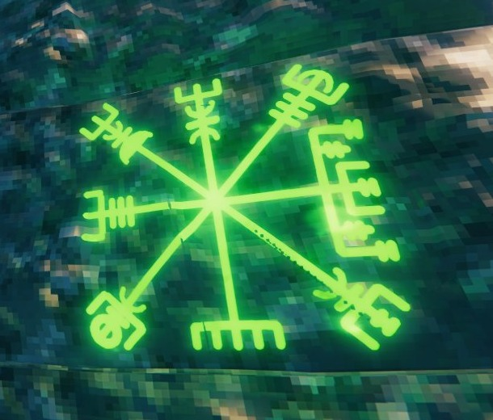
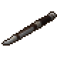
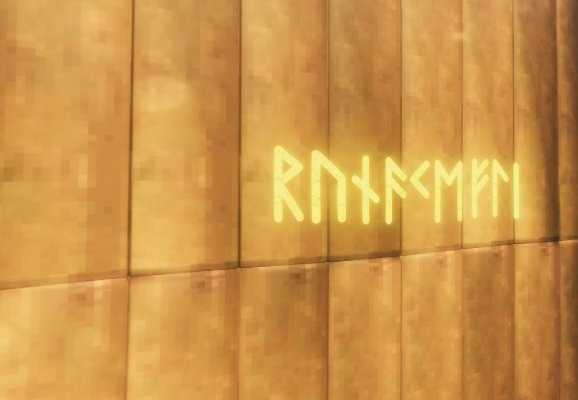
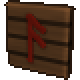
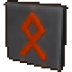
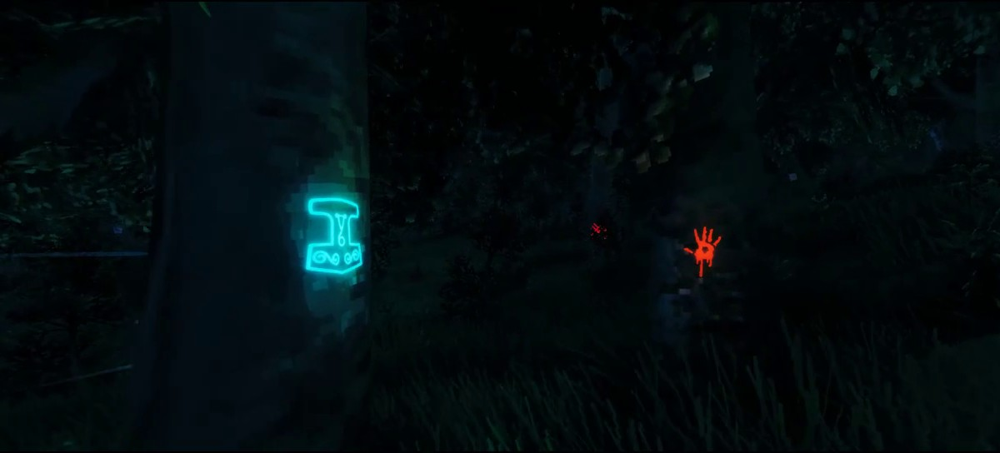
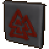
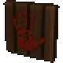
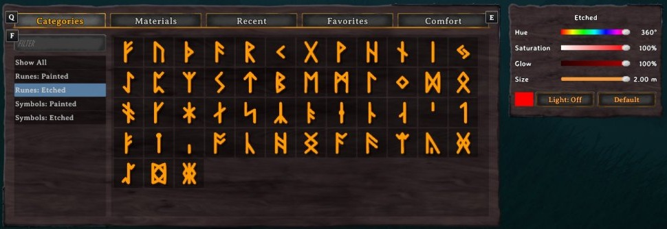
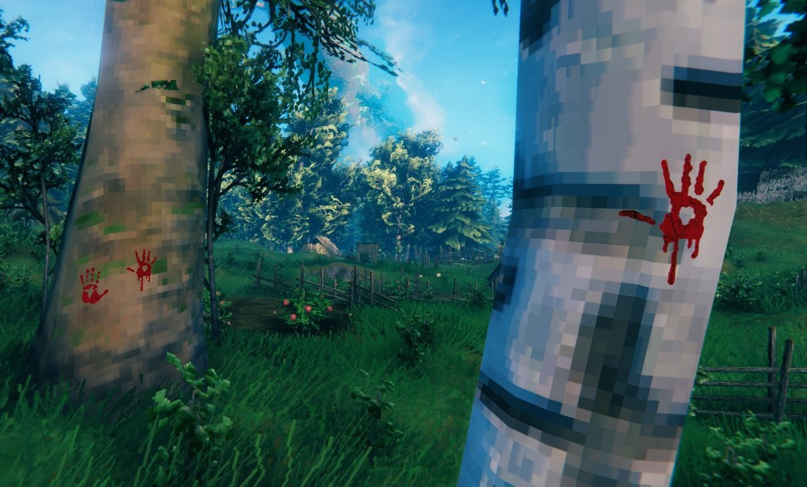

Paint runes and Norse symbols onto your walls, floors, rocks, trees and the ground with the Rúnakefli, a carved rune stick. The paint lies right on the surface, takes the world's light, follows the ground and bends with the bark when the wind moves a tree. Etched runes glow and light up what's around them.





**The Rúnakefli** is made at the workbench from 1 Hard Antler, 5 Ancient Bark, 10 Raspberries, 10 Blueberries and 3 Withered Bone. Equip it like the hammer and its build menu opens with four tabs: Runes: Painted, Runes: Etched, Symbols: Painted and Symbols: Etched. Aim, click and the rune goes on. The mouse wheel turns it, just as it turns a piece.





**51 runes**, every shape once: the Elder Futhark, then the runes the Younger Futhark adds (long-branch and short-twig), then the Anglo-Saxon futhorc's. Hover over one in the menu to see its name and meaning, with what the old rune poems say about it. A shape shared by several rows lists its other names too. A painted rune costs 1 Coal, since soot and charcoal were real rune paints.



**Etched runes glow.** They cost 1 Coal and 1 Resin, and each one gives off a soft light of its own colour that lights the wall and the floor around it at night. The light can be switched off per rune with the Light button in the panel. Like a torch's, it shines through walls unless you turn on Rune light shadows (see Settings). In sunlight the glow eases off a little so the colour still reads, while the paint itself keeps its true colour.





**Norse symbols** are unlocked by the first three bosses, four each. The left and right hand prints are yours from the start.

| Unlocked by | Symbols |
|---|---|
| From the start | Hand, left; Hand, right |
| Eikthyr | Vegvísir, Huginn and Muninn, Sleipnir, Gungnir |
| The Elder | Yggdrasil, Web of Wyrd, Troll cross, Mjölnir with knotwork |
| Bonemass | Valknut, Mjölnir, Triple Horn, Hand, bloody |



**The panel** sits beside the build menu. Pick the colour with Hue, Saturation and Brightness (Glow for etched runes), and the size from 0.25 to 2 m. Default puts it back to red ochre, or ember for etched runes, at 0.5 m. Painted and etched runes keep their own colour, and everything is saved with your character.



**Paint goes almost anywhere:** on building pieces (other mods' too), rocks, tree bark and the ground. On a tree only the bark takes paint, never the leaves or needles, and the rune sways with the trunk. On the ground it follows every bump, and the grass under it is left out so it stays visible. Dungeons are left alone.



- **Layers:** a new rune over an old one goes on top, so you can stack colours and sizes. The same rune in the same colour and size on the same spot is refused.
- **Taking it away:** middle mouse with the Rúnakefli takes the topmost rune you aim at and gives its Coal and Resin back. Wards and no-build areas count, as they do for the hammer.
- If the piece, rock or tree under a rune is broken, cut or removed, the rune goes with it.
- **Everyone needs it, the server included,** because the runes are part of your world.

## Settings

| Setting | Default | What it does |
|---|---|---|
| Rune light shadows | Off | Etched runes' lights cast shadows, so their light stops at walls instead of shining through. Costs some frame time (about 1 ms with 11 runes nearby). Only the nearest runes get shadows, as many as the game's Point light shadows setting allows. Your own setting, not the server's. |

Bug reports go to [GitHub Issues](https://github.com/TheRealRel/PotatoPainter/issues), where the source lives too. Questions are welcome on Discord: [relanebeis](https://discord.com/users/373574370267889674).

Needs [BepInExPack Valheim](https://thunderstore.io/c/valheim/p/denikson/BepInExPack_Valheim/) and [Jötunn](https://thunderstore.io/c/valheim/p/ValheimModding/Jotunn/).

The code is under the MIT License. The rune and symbol drawings, the Rúnakefli's model and textures, the icon, page icons and screenshots are © TheRealRel under [CC BY-NC 4.0](https://creativecommons.org/licenses/by-nc/4.0/): free to share and adapt with credit, but not for commercial use. See LICENSE for the details.

```
      .--------._
         (`--'       `-.
          `.______      `.
       ___________`__     \
    ,-'           `-.\     |
   //                \|    |\
  (`  .'~~~~~---\     \'   | |
   `-'           )     \   | |
      ,---------' - -.  `  . '
    ,'             `%`\`     |
   /                      \  |
  /     \-----.         \    `
 /|  ,_/      '-._            |
(-'  /           /            `
,`--<           |        \     \
\ |  \         /%%             `\
 |/   \____---'--`%        \     \
 |    '           `               \
 |
  `--.__
        `---._______
                    `.
                      \
```
